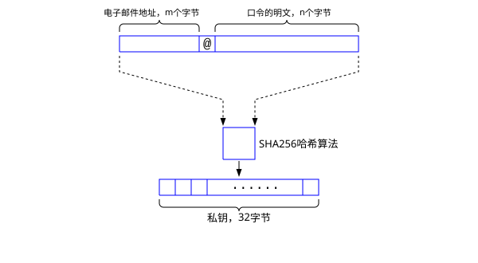

# 付费系统的设计方案

所有的字符串均统一为UTF8编码。

## 加密概述
非对称加密采用比特币所使用的secp256k1。对称加密采用AES256。哈希函数采用SHA256。

secp256k1的源码见：
https://github.com/bitcoin-core/secp256k1


## Web界面

用户通过Web界面实现用户的注册、登录、口令的变更、订阅付费套餐等功能。

用户名是用户的电子邮件地址。当用户注册新用户时，系统会发送一个验证邮件到用户的邮箱。用户点击邮箱中的验证链接后就完成了账号注册。

系统会根据用户的用户名USR和口令PWD，采用SHA256计算出一个32字节的数字，此即用户的私钥：
```
S = sha256(USR, PWD);
P = secp(S)
```
其中P是私钥S对应的公钥，长度为33个字节。 系统并不保存S，而是把记录<USR, P>保存在一张表U里。表U的主键(primary key)是USR，P也是唯一非空类型的列。U表的结构如下：
```
CREATE TABLE U(
  USR VARCHAR PRIMARY KEY,
  P CHAR(66) UNIQUE NOT NULL,
  ... -- 其它的用户信息
);
```

当用户输入USR, PWD时，通过计算P，和保存在U中的记录进行对比，从而验证用户是否合法。

下图是由用户名(电子邮件地址)和口令明文产生私钥的示意图：



如上所示，用户名，即电子邮件地址有m个字节(byte)，则m>=3。口令明文有n个字节，n>=8，表明口令最少8个字节。 

第一步是把电子邮件地址的字符串和口令明文的字符串拼接在一起。电子邮件地址在前，口令明文在后，中间用一个电子邮件的@符号进行分割，则输入的字节数量为m+n+1。

第二步是把第一步产生的字符串（长度为m+n+1）通过标准的SHA256算法，产生一个32字节的哈希值H。该哈希值H就是这个用户的私钥S。

第三步是把S当做Secp256k1算法的输入，产生对应的公钥P，公钥P的保存格式是压缩形式，长度为33个字节。具体的细节可以参考secp256k1的源码中包含的的示例代码，比较容易。

## ZTerm客户端

没有购买我们付费套餐的用户，无需操心用户名和口令的问题。
对于已经购买了付费套餐的用户，需要在客户端ZTerm中设置一下USR和PWD。

当用户需要解密某一个文档时，他的计算过程是这样的：
```
S = sha256(USR, PWD);
P = secp(S)
```
客户端发往服务器的数据包格式是：


具体信息参见：下面这个文档的“客户端向服务器索要解密密钥的数据包格式”。

https://github.com/wochatme/ZTerm/blob/main/doc/zterm.md


